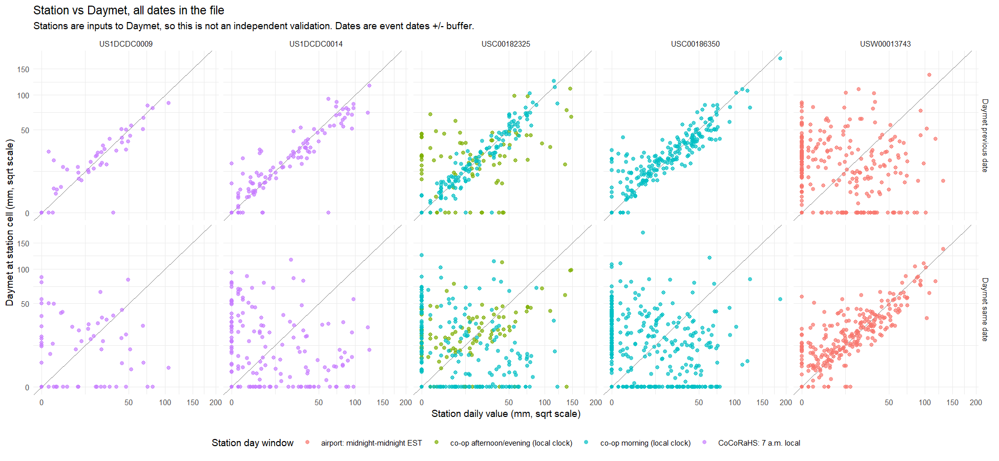

```{r setup, include=FALSE}
knitr::opts_chunk$set(echo = FALSE, message = FALSE, warning = FALSE)
source("R/dcflood_functions.R")
library(readr); library(dplyr); library(tidyr); library(knitr); library(ggplot2)
H5 <- "data/dc_flood.h5"
ev <- dc_events(H5)
```

This report is generated from `data/dc_flood.h5` (plus the retrieval logs in `data/derived/`).

# 1. What was requested

```{r request}
days <- .dc_flat(h5read(H5, "events/event_days"))
dcol <- intersect(c("est_date", "local_date"), names(days))[1]
n_dates_needed <- n_distinct(days[[dcol]])
tibble(item = c("Events supplied", "Unique calendar dates needed (event days plus 1-day buffer)",
                "Event time convention"),
       value = c(nrow(ev), n_dates_needed, "Fixed EST (UTC-5), no daylight saving")) |> kable()
```

# 2. Daymet (gridded)

```{r daymet}
cube_dates <- as.Date(as.vector(h5read(H5, "gridded/daymet/date")))
mask <- h5read(H5, "gridded/daymet/valid_mask")
attrs <- h5readAttributes(H5, "gridded/daymet/prcp")
needed <- sort(unique(as.Date(days[[dcol]])))
tibble(item = c("Dates needed", "Dates retrieved", "Needed dates missing from the file",
                "Grid size (x by y cells, 1 km)", "Cells inside the retrieved footprint",
                "Cells that are NoData on every date (outside footprint)"),
       value = c(length(needed), sum(needed %in% cube_dates), sum(!needed %in% cube_dates),
                 paste(dim(mask), collapse = " x "), sum(mask == 1), sum(mask == 0))) |> kable()
```

All dates were retrieved. Daymet uses a 365-day calendar, so 31 December is absent in leap years; need to check that no needed date falls on a leap-year 31 December:

```{r leap}
leap_dec31 <- needed[format(needed, "%m-%d") == "12-31" & as.integer(format(needed, "%Y")) %% 4 == 0]
if (length(leap_dec31)) print(leap_dec31) else cat("No needed date falls on a leap-year 31 December.\n")
```

**Time convention (assumed).** Daymet's day is 24 hours, local time, midnight to midnight ([ORNL guide](https://daac.ornl.gov/DAYMET/guides/Daymet_V4_Stn_Level_CrossVal.html)), but the guide does not say whether summer days use daylight time. We assume local standard time, which matches the EST event clock. If Daymet uses daylight time, rain between 23:00 and midnight EST during daylight saving belongs to the next Daymet date. The events below contain that hour.

```{r summer_midnight}
in_dst <- function(x) lubridate::dst(lubridate::with_tz(x, "America/New_York"))
hits_2300 <- function(b, e) {          # does [b, e] overlap any 23:00-24:00 EST hour?
  d <- seq(as.Date(format(b, "%Y-%m-%d", tz = EST_TZ)), as.Date(format(e, "%Y-%m-%d", tz = EST_TZ)), by = "day")
  s <- as.POSIXct(paste(d, "23:00:00"), tz = EST_TZ)
  any(b < s + 3600 & e > s)
}
near <- ev |>
  rowwise() |>
  mutate(affected = (in_dst(begin_est_dt) | in_dst(end_est_dt)) && hits_2300(begin_est_dt, end_est_dt)) |>
  ungroup() |> filter(affected) |> select(event_id, begin_est, end_est)
cat(nrow(near), "events in daylight-saving periods overlap 23:00-24:00 EST, the hour whose Daymet date depends on the assumption:\n")
kable(near)
```

# 3. Stations

```{r stations}
info <- dc_station_info(H5)
kable(info |> select(station_id, name, station_class, dist_to_dc_boundary_m, network))
```

Station classes come from a boundary test against the Census 1:500k outline (generalised, unreliable within a few hundred metres). Reagan National Airport is classed `airport_not_in_DC`: it is about 150 m outside the outline and is kept as a reference, not as an in-DC station. Dalecarlia was additionally confirmed inside DC on a map (Google Maps).

## Status of every needed date, by station

```{r status}
st_all <- bind_rows(lapply(info$station_id, function(id) .dc_station_full(H5, id)))
cnt <- st_all |> count(station, status) |> pivot_wider(names_from = status, values_from = n, values_fill = 0)
cnt$total <- rowSums(cnt[setdiff(names(cnt), "station")])
operating <- st_all |> filter(status != "outside_catalog_years") |> group_by(station) |>
  summarise(coverage_in_operating_years = round(mean(status %in% c("value", "value_quality_flagged")), 3))
kable(cnt |> left_join(operating, by = "station"))
```

Status meanings: `value` (a number was returned); `value_quality_flagged` (a number with a quality flag); `no_record` (the service returned nothing for that date); `returned_NA` (a row came back with an empty value); `outside_catalog_years` (the station did not report that year, per the catalogue). `outside_catalog_years` is not missing data. The two volunteer stations began reporting in 2008 and 2011. A rate that treats these days as missing understates their real coverage.

## Observation hours

```{r obs}
kable(info |> select(station_id, obs_time_counts))
```

Each station value is the total for the 24 hours ending at the reading. On the fixed EST event clock:

| Station type | Rule | Window ends (winter) | Window ends (summer) |
|------------------|------------------|------------------|------------------|
| Airport (Reagan National) | NWS climatological day, local standard time ([NWS](https://www.weather.gov/lot/weather_observations_faq)) | 24:00 EST | 24:00 EST |
| Co-op (Arboretum, Dalecarlia) | reported hour, local clock time ([NWS co-op manual](https://www.weather.gov/media/lwx/coop/COOP%20Station%20Observations.pdf)) | e.g. 08:00 | e.g. 07:00 (08:00 EDT) |
| CoCoRaHS (US1 stations) | 0700 local time ([CoCoRaHS](https://www.cocorahs.org/content.aspx?page=aboutqc)); no hour in the record | 07:00 | 06:00 |

The CoCoRaHS row assumes 0700 is clock time, including daylight saving, as for co-op observers; CoCoRaHS does not say.

The US1 prefix is GHCN-Daily network code 1, CoCoRaHS ([GHCN-Daily readme](https://www.ncei.noaa.gov/pub/data/ghcn/daily/readme.txt)).

# 4. Coverage per event

```{r cov}
cov <- dc_coverage(H5)
summ <- cov |> group_by(station) |>
  summarise(events_complete = sum(frac_with_value == 1),
            events_partial  = sum(frac_with_value > 0 & frac_with_value < 1),
            events_none     = sum(frac_with_value == 0), .groups = "drop")
kable(summ)
```

"Complete" means every event date has a value. The volunteer stations show many "none" events mainly because the events predate the stations.

```{r cov_all5}
five <- cov |> filter(station != "DAYMET (grid)") |> group_by(event_id) |>
  summarise(n_complete = sum(frac_with_value == 1), .groups = "drop")
cat(sum(five$n_complete == 5), "events have all five stations complete:",
    paste(five$event_id[five$n_complete == 5], collapse = ", "), "\n")
```

# 5. Retrieval history, including what failed

```{r threds}
f <- "data/derived/daymet_download_log.csv"
if (file.exists(f)) {
  lg <- read_csv(f, show_col_types = FALSE)
  cat("First attempt: ORNL THREDDS/NCSS through the `daymetr` package, one request per year.\n")
  print(kable(count(lg, status)))
}
```

All 28 yearly requests through THREDDS failed, so the data were retrieved from NASA AppEEARS (product DAYMET.004, layer prcp, native projection, no resampling). The THREDDS log is kept as evidence of the failed route.

```{r appeears}
tasks <- .dc_flat(h5read(H5, "metadata/appeears_tasks"))
cat(nrow(tasks), "AppEEARS tasks, one per year. Full table in /metadata/appeears_tasks.\n")
```

```{r requests}
rq <- .dc_flat(h5read(H5, "metadata/station_requests"))
kable(count(rq, outcome))
bad <- rq |> filter(outcome != "ok")
if (nrow(bad)) kable(bad |> select(station, year, attempts, outcome)) else cat("No station request failed after retries in the final run.\n")
```

`ok_empty` means a station-data request to NOAA succeeded but the station had no PRCP rows in that year. These are not failures: none of the 117 station-data requests failed after retries. (The Daymet requests through THREDDS, above, did all fail.).

Earlier runs had DNS failures that were misread as "no record"; the final download script retries four times and records `download_failed` instead.

## Station search

Stations were searched in one archive: NOAA's GHCN-Daily station catalogue, accessed through the NCEI Access Data Service. The search returned 70 candidates near DC, and five were kept. Other stations were either outside DC, did not have data in requested years, or had too short of a timespan (Section 3).

GHCN-Daily already includes some CoCoRaHS volunteer stations (network code 1), and the two US1 stations here are CoCoRaHS. No other station source was searched: not CoCoRaHS's own archive, USGS gauges, DC government data, or private weather networks. Stations reported only in those sources are therefore not in this database.

# 6. Time windows: station versus Daymet

Station values are labelled by date, but each covers the 24 hours ending at the station's reading. Morning readers (co-op and CoCoRaHS) end their day around 06:00 to 08:00 EST, so most of their total fell on the previous calendar day. The airport and Daymet use a calendar day. For the same storm, a morning station and a calendar-day product put the rain on different dates. In E074 (2017-07-28 11:45 to 07-29 07:40 EST) the four morning-reading stations (co-op and CoCoRaHS) show the rain under 07-29, while Reagan National (midnight day) shows 84 mm on 07-28 and 12 mm on 07-29.

```{r metrics}
mf <- "data/derived/station_vs_daymet_metrics.csv"
if (file.exists(mf)) kable(read_csv(mf, show_col_types = FALSE) |> mutate(across(where(is.double), ~ round(.x, 2))))
```

Morning-reading stations (co-op and CoCoRaHS) correlate at 0.92 to 0.96 with Daymet's **previous** date and near 0 with the same date. Reagan National (midnight) is the reverse. These stations feed Daymet, so this is consistency, not validation, and the dates are event dates plus a buffer.

```{r fig, out.width="100%"}
if (file.exists("figures/station_vs_daymet.png")) 
```

# 7. Event timing flags

```{r flags}
fl <- grep("^flag_", names(ev), value = TRUE)
kable(tibble(flag = fl, events = sapply(fl, function(k) sum(as.integer(ev[[k]]), na.rm = TRUE))))
```

# 8. Limitations

- **Daymet day boundary.** Daymet's day is 24 hours, local time, midnight to midnight ([ORNL guide](https://daac.ornl.gov/DAYMET/guides/Daymet_V4_Stn_Level_CrossVal.html)). The guide does not say whether summer days use daylight time. We assume local standard time, which equals the EST event clock (as for the NWS climatological day). If Daymet uses daylight time in summer, its summer day runs 23:00 to 23:00 EST, so rain between 23:00 and midnight EST could belong to the next Daymet date. The report lists the summer events this could affect.
- CoCoRaHS records carry no reading hour; the 7 a.m. local rule is the network's standard, so individual days may differ. That a value is labelled with the date of the reading is inferred from the data (Section 6), not stated by the data service.
- Station and Daymet comparisons are not independent: GHCN-Daily stations are Daymet inputs.
- The Census boundary is generalised, so the classification of stations within a few hundred metres of the border is uncertain.
- Water bodies are not drawn on the maps.
- AppEEARS results expire after 30 days; the HDF5 file is the archived copy.
- Only GHCN-Daily was searched for stations. In-DC gauges reported only to other networks (CoCoRaHS-only observers, USGS, DC agencies, private networks) are not included.
- CoCoRaHS accepts multi-day reports. Only daily PRCP was downloaded, so days covered by a multi-day total may appear as no_record at the two CoCoRaHS stations (not checked).
